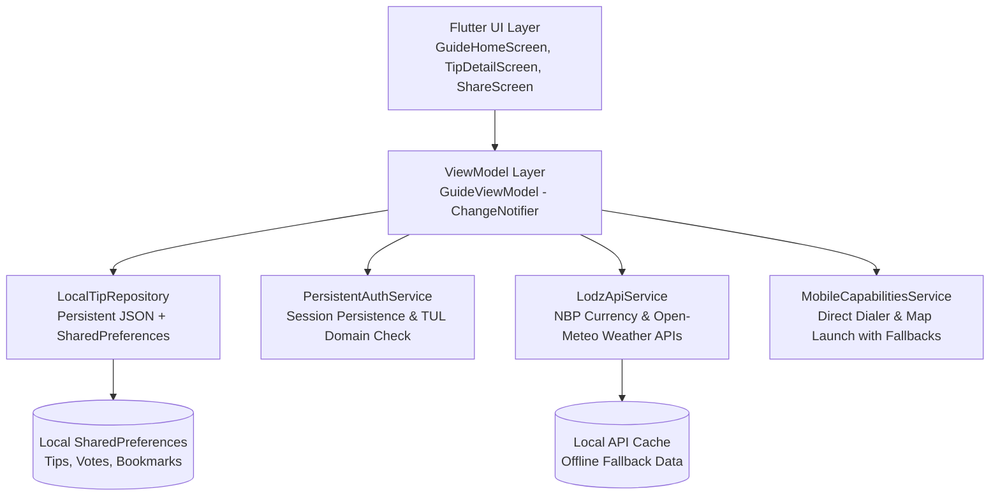

# M2 Milestone — Working MVP Demonstration Report (Studio 9)

**Project:** Erasmus Student Guide (Lodz University of Technology - PŁ)  
**Team Members:** Yusuf Taskin · Aldiyar Kairolla · Engin Yurt  
**Repository:** `https://github.com/EnginCelalYurt/erasmus_student_guide`  
**Target Platform:** Flutter (Mobile Android/iOS, Web, Windows)  

---

## 1. Executive Summary & MVP Scope

The **Erasmus Student Guide** is a student-powered mobile application designed for incoming exchange students at Lodz University of Technology (TUL / Politechnika Łódzka). It solves the problem of scattered, informal, and Polish-only arrival information by providing a curated, community-ranked guide, offline-first reliability, emergency capabilities, and verified student sharing.

### Core User Journey Demonstrated:
$$\text{Incoming Student Lands} \longrightarrow \text{Checks Live Rates \& Weather} \longrightarrow \text{Browses Tips by Category} \longrightarrow \text{Votes on Helpful Advice} \longrightarrow \text{Signs in via TUL Email} \longrightarrow \text{Publishes Advice}$$

---

## 2. Technical Architecture & Data Flow

---

## 3. Required Evidence Checklist (M2)

### A. Local Persistence (Survives App Restart)
* **Storage Engine:** `SharedPreferences` with structured JSON serialization.
* **Persistent Entities:**
  1. `erasmus_guide_local_tips_v2`: All student-submitted tips survive complete application termination.
  2. `erasmus_guide_local_votes_v2`: User voting history (`helpful` / `notHelpful`) is preserved to prevent duplicate voting.
  3. `erasmus_guide_auth_email_v2`: Restores student authentication across restarts.
  4. `uniguide_v2_prefs`: Bookmarks, checklist progress, and dark/light theme choices.

### B. API Integration & Offline Reliability (Week 7)
* **Real Public APIs Integrated:**
  - **National Bank of Poland (NBP API):** Real-time EUR to PLN exchange rate (`https://api.nbp.pl/api/exchangerates/rates/a/eur/?format=json`).
  - **Open-Meteo Campus Weather API:** Live temperature and weather for Łódź coordinates (`51.75°N, 19.45°E`).
* **Offline Fallback Behavior:**
  - When connection is active: Displays green `LIVE ŁÓDŹ CAMPUS INFO` badge.
  - When offline or request fails: Seamlessly recovers cached data and displays amber `CACHED OFFLINE DATA · Tap to retry` banner without blocking the UI or throwing unhandled exceptions.

### C. Mobile Capability & Denied/Unavailable Fallback (Week 8)
* **Justified Capability:** One-tap Emergency Calling (`tel:112` and PŁ Security `tel:+48426312999`).
* **Denied / Unavailable Fallback:** On devices without a telephone dialer (tablets, desktop, emulators, or restricted permissions), the app catches the condition and **automatically copies the emergency number to the system clipboard** while alerting the user via an accessible SnackBar.

### D. Accessibility Requirements (WCAG AA)
1. **Contrast Ratio:** Text and interactive buttons adhere to WCAG AA 4.5:1 minimum contrast across both light (paper) and dark (brick) themes.
2. **Accessible Semantics:** All icon-only actions (emergency call, bookmark, refresh, vote) provide explicit `tooltip` and semantic accessibility labels for screen readers (TalkBack / VoiceOver).

---

## 4. Manual Scenario Testing Matrix

| Scenario | Steps | Expected Outcome | Actual Result |
|---|---|---|---|
| **Normal Path** | 1. Open app 2. Select 'Transport' 3. Open Jakdojade tip 4. Tap 'Helpful' | Tip votes increment, Wilson score updates, tip rises in rank | ✅ Passed |
| **Network Failure** | 1. Disable Wi-Fi / Mobile Data 2. Launch app 3. Tap Refresh on rates | Live widget displays cached rates with amber offline indicator; no crash | ✅ Passed |
| **App Restart** | 1. Sign in as `yusuf.taskin@edu.p.lodz.pl` 2. Post a tip 3. Terminate app 4. Reopen | User remains signed in; custom tip is restored at top of the feed | ✅ Passed |
| **Permission Denied** | 1. Run app on tablet/Windows 2. Tap 112 emergency banner | Phone app does not fail silently; number '112' is copied to clipboard with notification | ✅ Passed |
| **Invalid Input** | 1. Go to Share tab 2. Enter 5-character body 3. Tap Submit | Inline validator prevents submission: "Write at least 15 characters" | ✅ Passed |

---

## 5. Automated Logic Test Suite

The project includes automated tests in [`test/widget_test.dart`](file:///C:/Users/yusuf/.gemini/antigravity/scratch/erasmus_student_guide/test/widget_test.dart):
1. `LodzApiService falls back to cached data when offline`
2. `Emergency dialer number sanitation format`
3. `LocalTipRepository persists and restores created tips across app restarts`
4. `LocalTipRepository persists user votes across app restarts`
5. `PersistentAuthService restores user session after app restart`
6. `GuideViewModel loads, filters and ranks tips with Wilson score`
7. `App displays Guide, Live Info Banner, 112 Banner and Navigation Tabs`

---

## 6. M2 Submission Summary

* **Repository:** `https://github.com/EnginCelalYurt/erasmus_student_guide.git`
* **Branch:** `prototype`
* **Score Allocation Target:** 25 / 25 points (Working MVP, Technical Architecture, Failure Demonstrations).
